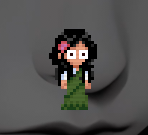

# Pixel-Friend
pixel friend is a cute pixel art desk buddy! shes really expressive.

# Screenshot 

# How to install (onlt for win for now)
to intall pixel friend just simply intall the latest .exe file from the release. and double click to run it!

# future
honesty just made this for my friend but i have plans to add mode expression and character and even actual useful funtion in the future after i get some time off from college.

# AI used in this project
there were a few days i used ai which is. 
1. mouse input function whichi didnt know you can do that in that way.
2. debugging the code. i was having hard time on some mitchmatch expression happening in unwated time. as i did not use seperate timer before
so ended up adding seperate timer with the help of gpt.
3. making the shader. i tried to follow a tutorial but it was not working well for my case cus i wanted the crt effect to only happen on the character model so give gpt to modify it.
and thats all the gpt used. 

NO AI WAS USED IN THE ART
